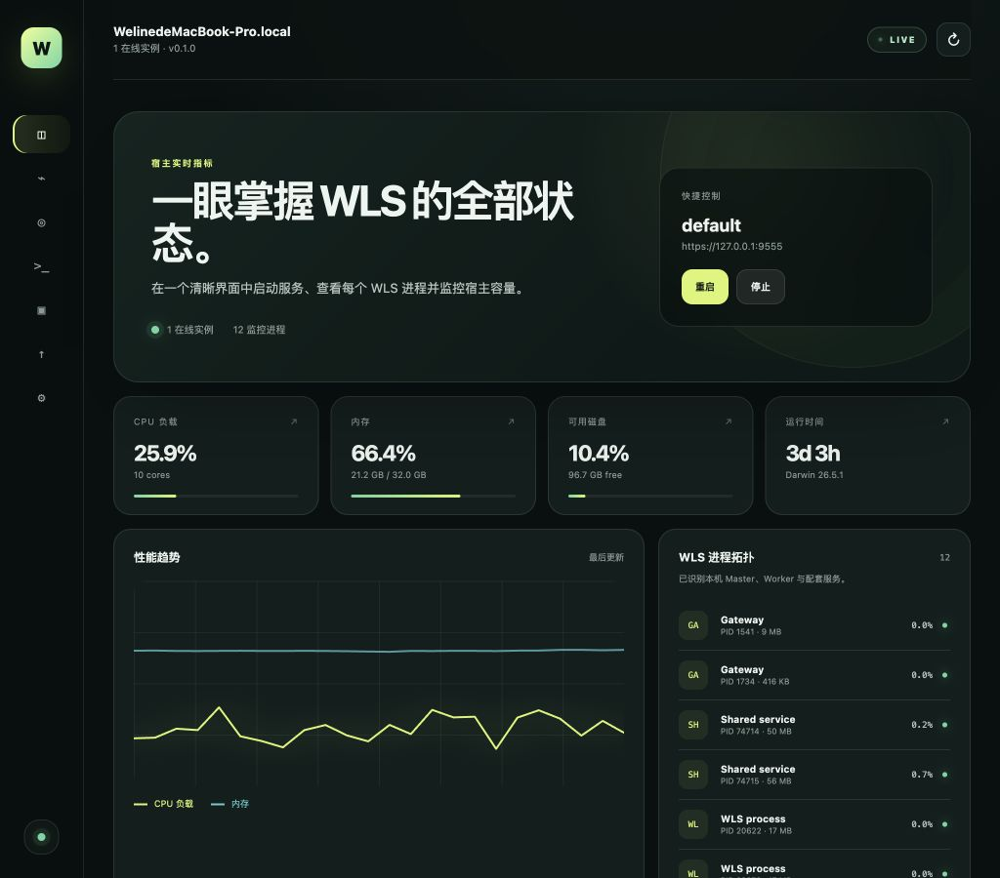
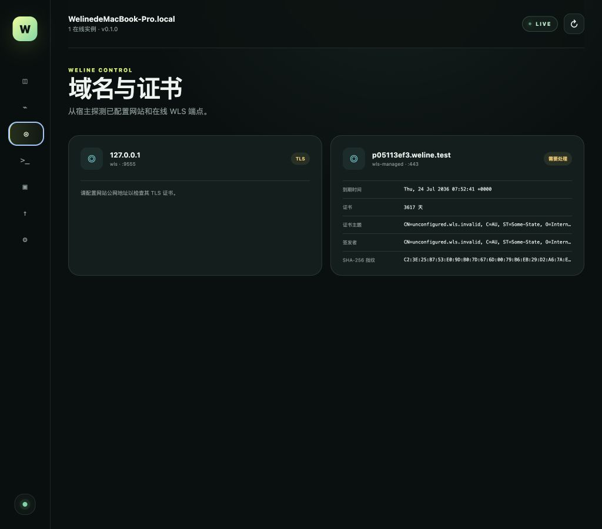
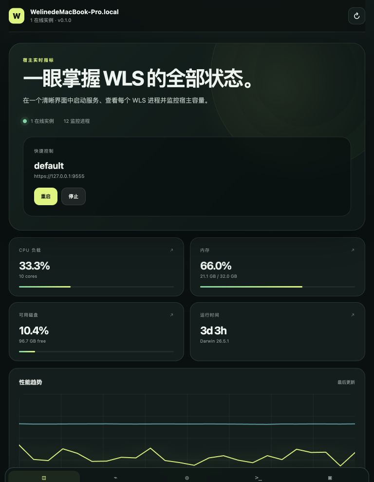
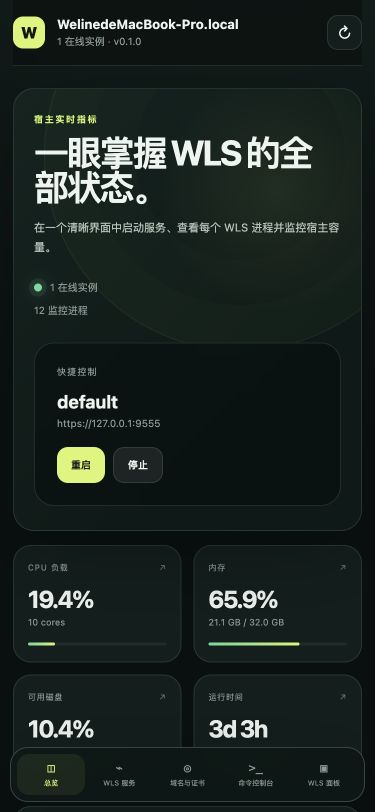

<p align="center">
  
</p>

<h1 align="center">Weline Control Center</h1>

<p align="center">
  <strong>跨平台 WLS 控制中心</strong> · 本机一键启停 · 宿主监控 · 证书可视 · 受限命令台
</p>

<p align="center">
  <a href="https://gitee.com/aiweline/weline-gui/releases/tag/v0.1.0-packages"></a>
  
  
  
  
</p>

<p align="center">
  <a href="https://gitee.com/aiweline/weline-gui/releases/tag/v0.1.0-packages"><strong>下载安装包</strong></a>
  ·
  <a href="https://github.com/Aiweline/weline-gui/releases/tag/v0.1.0-packages">GitHub Releases</a>
  ·
  <a href="#本地开发">本地开发</a>
  ·
  <a href="docs/AGENT_HTTP_UNIFIED.md">Agent HTTP 硬约束</a>
</p>

---

<p align="center">
  
</p>

<p align="center"><sub>仪表盘 · 一眼掌握在线实例、宿主容量与 WLS 进程拓扑</sub></p>

## 为什么需要它

Weline Control Center 是与框架**同级独立仓**的桌面 / Agent UI。  
桌面端直接管理本机 WLS；手机与浏览器通过同一套 Rust 宿主代理远程接管服务器——不是在手机里假跑 PHP。

| 你想做的事 | 控制中心怎么做 |
| --- | --- |
| 启停 / 重启 / 热重载 WLS | 一键操作，数据来自 `server:list --json` |
| 看 CPU / 内存 / 磁盘 / 进程 | 实时宿主指标 + WLS 进程树 |
| 查站点 TLS | 域名池合并探测，指纹 / 有效期 / 主机名匹配 |
| 跑框架命令 | 仅允许参数化 `php bin/w …`，不经 Shell |
| 无桌面机房 | `weline-agent` + 响应式 Web UI |

## 安装包（请下这个，不是源码 ZIP）

<p align="center">

| 平台 | 安装包 | 一键下载 |
| --- | --- | --- |
| **macOS** Apple Silicon | `.dmg` | [下载 DMG](https://gitee.com/aiweline/weline-gui/releases/download/v0.1.0-packages/Weline-Control-Center-0.1.0-macos-aarch64.dmg) |
| **Windows** x64 | `.exe` Setup | [下载 Setup](https://gitee.com/aiweline/weline-gui/releases/download/v0.1.0-packages/Weline-Control-Center-0.1.0-windows-x64-setup.exe) |
| **Linux** amd64 | `.deb` | [下载 DEB](https://gitee.com/aiweline/weline-gui/releases/download/v0.1.0-packages/Weline-Control-Center-0.1.0-linux-amd64.deb) |
| **Linux** amd64 | `.AppImage` | [下载 AppImage](https://gitee.com/aiweline/weline-gui/releases/download/v0.1.0-packages/Weline-Control-Center-0.1.0-linux-amd64.AppImage) |

</p>

完整校验与发布说明见  
[Gitee Releases · v0.1.0-packages](https://gitee.com/aiweline/weline-gui/releases/tag/v0.1.0-packages) ·  
[GitHub Releases](https://github.com/Aiweline/weline-gui/releases/tag/v0.1.0-packages)

> **以后发版**：`./scripts/release.sh <版本>`（或 push `v*` 标签）→ GitHub Actions **一次打出全端安装包**。  
> 禁止本机挨个平台打包再手工上传。详见 [docs/RELEASE.md](docs/RELEASE.md)。

## 界面一览

### 域名与证书

<p align="center">
  
</p>

<p align="center"><sub>从宿主合并已启用域名与显式网站 URL，展示签发者、剩余天数、SHA-256 指纹</sub></p>

### 同一套 UI，桌面到手机

<p align="center">
  
  &nbsp;&nbsp;
  
</p>

<p align="center"><sub>375 · 768 · 1024 · 更宽视口同一前端；无桌面 Linux 也可走 Agent Web</sub></p>

## 平台矩阵

| 平台 | 形态 | 本机启动 WLS | 状态 |
| --- | --- | :---: | --- |
| Windows | Tauri 桌面 | ✅ | 安装包已发布 |
| macOS | Tauri 桌面 | ✅ | 安装包已发布（Apple Silicon） |
| Linux 桌面 | Tauri 桌面 | ✅ | 安装包已发布（DEB / AppImage） |
| Linux 无桌面 | Agent + Web | ✅ | 脚本安装已验证 |
| iOS / iPadOS | 移动客户端 | ❌ 远程宿主 | 工程支持，需 Apple 签名 |
| Android | 移动客户端 | ❌ 远程宿主 | 工程支持，需商店签名 |

## 能力清单

- **安装向导 + 10 语种**：English / 简体中文 / Español / हिन्दी / العربية（RTL）/ Português / Français / Deutsch / 日本語 / 한국어  
- **实例运维**：启动、停止、重启、热重载  
- **宿主监控**：CPU、内存、Swap、磁盘、网络、负载、运行时间、WLS 进程树  
- **证书可视**：主题、签发者、有效期、指纹、主机名匹配；删除托管证书时二次确认  
- **受限控制台**：只跑参数化 `php bin/w`  
- **内嵌 WLS 面板**：目标站禁 iframe 时可新窗口打开  
- **统一 Agent HTTP**：桌面 / Vite Web / `weline-agent` 同一 `/api/v1/*`，禁止另写业务通道  

## 本地开发

需要 Node.js 22+、Rust 1.95+、PHP，以及可运行的 Weline 框架。

```bash
npm ci
npm run check
npm run tauri dev
```

**硬约束**：桌面 / Vite Web / `weline-agent` 的业务 I/O 必须统一走 Agent HTTP  
（`/api/v1/*` → `AgentService`）。详见 [docs/AGENT_HTTP_UNIFIED.md](docs/AGENT_HTTP_UNIFIED.md)。

`tauri dev` 会内嵌 `127.0.0.1:17640`。纯浏览器调试：

```bash
npm run agent      # 终端 1
npm run dev:web    # 终端 2，Vite 代理 /api → Agent
```

首次启动选语言；桌面选「管理本机」。本机模式会 `GET /api/v1/projects/scan` 扫描附近项目。

## 无桌面 Linux

```bash
./scripts/install-headless-linux.sh /absolute/path/to/Weline
```

默认只听 `127.0.0.1:17640`：

```text
http://127.0.0.1:17640
```

```bash
weline-agent token
weline-agent token --rotate
```

公网暴露必须同时给 `--tls-cert` / `--tls-key`，或经 HTTPS 反代到回环。

## 文档

| 文档 | 用途 |
| --- | --- |
| [Agent HTTP 统一](docs/AGENT_HTTP_UNIFIED.md) | 改接口前必读 |
| [架构](docs/ARCHITECTURE.md) | 数据流 |
| [安全](docs/SECURITY.md) | 信任边界 |
| [发布](docs/RELEASE.md) | 打包与签名 |
| [验收](docs/ACCEPTANCE.md) | 运行记录 |

## 常用命令

```bash
npm run test
npm run build
cargo test --manifest-path src-tauri/Cargo.toml
npm run tauri build
```
