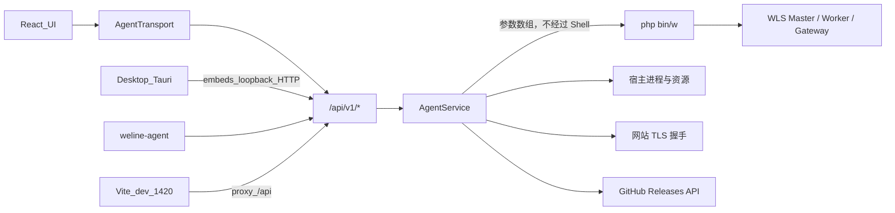

# 架构与数据流

> **硬约束（强制）**：桌面 / Web / 无桌面 agent **必须统一**走 Agent HTTP `/api/v1/*` → `AgentService`。  
> 禁止业务层 Tauri `invoke`、禁止 Vite/Node 平行扫描或其它第二套业务通道。  
> 完整条文与自检清单见 **[AGENT_HTTP_UNIFIED.md](AGENT_HTTP_UNIFIED.md)**（改代码前必读）。

## 运行形态

桌面应用、浏览器开发态与无桌面 `weline-agent` **共用同一套** `AgentService` 与版本化 REST API。前端业务**只**调用 `/api/v1/*`，不再按环境分叉到 Tauri IPC。

| 宿主 | 如何到达 Agent HTTP |
| --- | --- |
| 桌面 Tauri | 进程内嵌 `http::serve`（默认 `127.0.0.1:17640`）；可选 `get_local_agent_endpoint` 注入 URL/token |
| Vite 开发（`:1420`） | `server.proxy['/api']` → 同上 Agent；`GET /api/v1/local-session`（仅 loopback）取 token |
| 无桌面 Linux / 远程 | `weline-agent serve` 提供同一 API（非回环须 TLS） |

本机模式引导：`GET /api/v1/local-session`（peer 必须为 loopback）返回 `{ agentUrl, token, listen }`，之后所有受保护端点使用 `Authorization: Bearer <token>`。

### 桌面 / 回环 Web 全通（客户端门禁）

业务配置（框架目录、网站、域名池）以 **agent** 为准；各浏览器自己的 `localStorage.setupComplete` 只是缓存，不是第二套真相。

回环打开控制中心时，前端走 `resolveLocalBootstrap` 三态：

| 状态 | 条件 | UI |
| --- | --- | --- |
| `resumed` | `local-session` 成功且 `config.configured` + `frameworkRoot` | 直进主界面（跳过向导） |
| `needs_setup` | agent 可达但尚未配置项目 | SetupWizard |
| `offline` | agent 不可达 | OfflineGate（提示启动 `npm run agent` / 桌面端），**不**伪装成「选择宿主」 |

非回环远程端仍显式填写 Agent URL + token。浏览器不会自动拉起 agent 进程。

### 传输边界（勿突破）

| 允许 | 禁止 |
| --- | --- |
| `AgentTransport` → `fetch('/api/v1/...')` | 前端业务 `invoke('scan_*' / 'get_snapshot' / …)` |
| 业务只在 `AgentService` + `http.rs` | Vite/Node 再实现项目扫描或其它业务 |
| 桌面仅引导 IPC：`get_local_agent_endpoint` | 桌面一套 API、浏览器另一套「修好 Web」的平行层 |
| `discover.rs` 经 `GET /api/v1/projects/scan` | SPA HTML / 非 JSON 冒充 API 成功响应 |

## 目录

- `src/`：React 界面、首次安装、多语言与 **HTTP-only** 传输适配器。
- `src-tauri/src/service.rs`：WLS 生命周期、快照聚合与受限命令执行。
- `src-tauri/src/http.rs`：Agent HTTP 面（鉴权、CORS、TLS 限制、静态托管）。
- `src-tauri/src/discover.rs`：本机项目扫描（桌面与 agent 共用）。
- `src-tauri/src/tls.rs`：对网站端点进行 TLS 握手并解析 X.509。
- `src-tauri/src/update.rs`：GitHub 正式 Release 与语义版本判断。
- `src-tauri/src/bin/weline-agent.rs`：Linux/headless 入口。
- `packaging/`：系统服务模板。

## API v1

`GET /api/v1/health` 与 **loopback-only** `GET /api/v1/local-session` 无需 Bearer。以下端点均要求 `Authorization: Bearer <token>`：

| 方法 | 路径 | 用途 |
| --- | --- | --- |
| GET | `/api/v1/local-session` | 回环引导：返回 agentUrl + token（非 loopback → 403） |
| GET / PUT | `/api/v1/config` | 读取/保存非敏感配置 |
| GET | `/api/v1/snapshot` | 宿主、进程、WLS、网站与证书快照 |
| POST | `/api/v1/wls/control` | start/stop/restart/reload/status |
| POST | `/api/v1/console` | 运行受限框架 CLI |
| POST | `/api/v1/certificates/delete` | 删除托管证书；若仍被站点引用且未 `confirm`，返回 `needsConfirmation` |
| GET | `/api/v1/update` | 检查 GitHub 最新正式 Release |
| GET | `/api/v1/projects/scan` | 扫描本机 Weline 项目（运行中的优先） |
| GET | `/api/v1/websites` | 网站列表 |
| GET | `/api/v1/websites/domain-pool` | 域名池列表 |
| POST | `/api/v1/open-external` | 本机打开外部 URL（http/https） |
| WS | `/api/v1/ssh/session?token=` | 内置 SSH 终端桥（Agent Bearer via query；首帧 JSON `connect` 含私钥 PEM，Agent **不持久化**） |

### 多机 Host Profile（客户端）

- `localStorage.weline.hosts` + `weline.activeHostId`：多 Host Profile；每档含 Agent URL/token、**绑定项目** `frameworkRoot`/`phpBinary`、可选 Framework API 站点账户、SSH 元数据与 `sshPrivateKeyRef`（**永不存 PEM**）。
- **项目作用域（硬）**：Agent 进程内只有一份当前 `frameworkRoot`。切换 Host 时前端必须先按该 Profile 的 `frameworkRoot` 调用 `PUT /api/v1/config` 激活项目，再拉 snapshot / console / websites；禁止用上一项目的命令树或网站列表。
- 私钥：Web 默认 `session_only` 内存；可选 WebCrypto 加密 IndexedDB；桌面后续 `os_keychain`。
- Framework 业务 REST：GUI `FrameworkApiSdk` → 站点 `/api/api/rest/v1/auth/login`（账户登录，token 放 `sessionStorage` 按 profile 隔离）。
- 内置终端：xterm.js → Agent `WS /api/v1/ssh/session` → OpenSSH PTY（仅公钥认证）；本地 shell 默认 cwd 为当前绑定项目。

访问令牌不会通过配置 API 返回。服务实例缓存 10 秒、证书探测缓存 60 秒，以避免高频执行框架命令或 TLS 握手。

## 网站与证书来源

代理合并四类来源：设置中明确填写的网站 URL、管理面板 URL、运行中的 WLS 端点，以及 `server:ssl:auto list` 返回的已启用非通配符域名。当前 WLS 的证书清单命令尚未提供稳定 JSON 输出，因此最后一种来源使用只读兼容解析器，并以 60 秒缓存限制调用频率；设置中的完整 `https://` URL 仍是最稳定的显式来源。

TLS 探测从宿主网络对目标地址实际握手，而不是只读取证书文件。即使证书过期或域名不匹配，探测器也会保留其主题、签发者、有效期和 SHA-256 指纹用于诊断；界面的“有效”表示证书处于有效期内且 SAN/CN 匹配目标主机名，不代表独立完成系统 CA 信任链验证。
