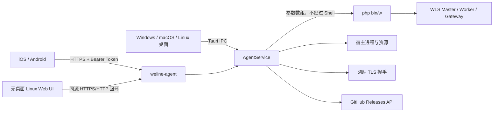

# 架构与数据流

## 运行形态

桌面应用和无桌面代理复用同一个 `AgentService`，因此服务控制、指标、证书与更新判断只有一份实现。区别仅在传输层：桌面走 Tauri IPC，远程客户端走版本化 REST API。

## 目录

- `src/`：React 界面、首次安装、多语言与传输适配器。
- `src-tauri/src/service.rs`：WLS 生命周期、快照聚合与受限命令执行。
- `src-tauri/src/http.rs`：无桌面 Linux Web/API 服务、鉴权、TLS 监听限制。
- `src-tauri/src/tls.rs`：对网站端点进行 TLS 握手并解析 X.509。
- `src-tauri/src/update.rs`：GitHub 正式 Release 与语义版本判断。
- `src-tauri/src/bin/weline-agent.rs`：Linux/headless 入口。
- `packaging/`：系统服务模板。

## API v1

`GET /api/v1/health` 是唯一无需令牌的端点，只返回健康状态、版本与时间。以下端点均要求 `Authorization: Bearer <token>`：

| 方法 | 路径 | 用途 |
| --- | --- | --- |
| GET / PUT | `/api/v1/config` | 读取/保存非敏感配置 |
| GET | `/api/v1/snapshot` | 宿主、进程、WLS、网站与证书快照 |
| POST | `/api/v1/wls/control` | start/stop/restart/reload/status |
| POST | `/api/v1/console` | 运行受限框架 CLI |
| POST | `/api/v1/certificates/delete` | 删除托管证书；若仍被站点引用且未 `confirm`，返回 `needsConfirmation` |
| GET | `/api/v1/update` | 检查 GitHub 最新正式 Release |
| GET | `/api/v1/projects/scan` | 扫描本机 Weline 项目（运行中的优先） |

访问令牌不会通过配置 API 返回。服务实例缓存 10 秒、证书探测缓存 60 秒，以避免高频执行框架命令或 TLS 握手。

## 网站与证书来源

代理合并四类来源：设置中明确填写的网站 URL、管理面板 URL、运行中的 WLS 端点，以及 `server:ssl:auto list` 返回的已启用非通配符域名。当前 WLS 的证书清单命令尚未提供稳定 JSON 输出，因此最后一种来源使用只读兼容解析器，并以 60 秒缓存限制调用频率；设置中的完整 `https://` URL 仍是最稳定的显式来源。

TLS 探测从宿主网络对目标地址实际握手，而不是只读取证书文件。即使证书过期或域名不匹配，探测器也会保留其主题、签发者、有效期和 SHA-256 指纹用于诊断；界面的“有效”表示证书处于有效期内且 SAN/CN 匹配目标主机名，不代表独立完成系统 CA 信任链验证。
